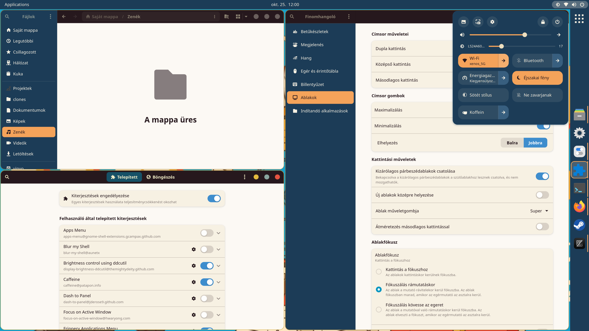
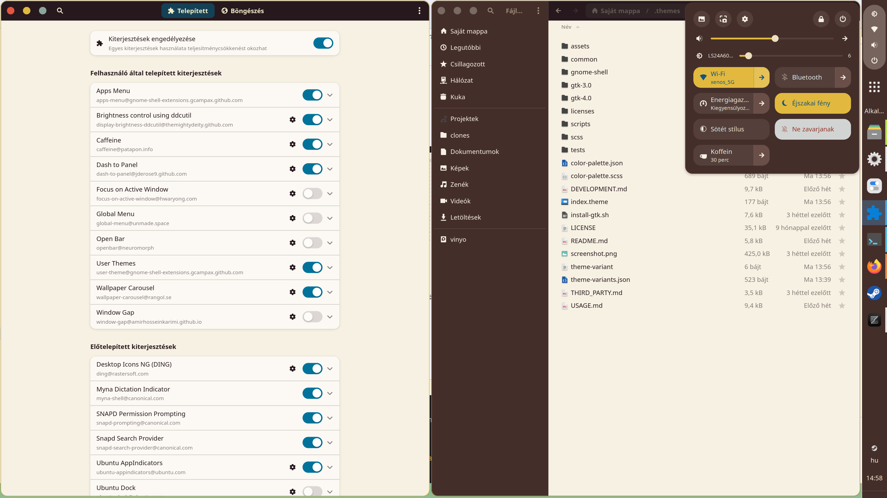

# Viparu

Viparu is a Yaru-based theme for **GTK 3, GTK 4 and GNOME Shell**, combining
light content areas, dark headers and sidebars, warm highlights and colored
window buttons.

Choose between two color variants:

| Variant | Appearance | Theme name |
| --- | --- | --- |
| **Nile Blue** | Petrol-blue sidebars, light content areas and orange highlights | `Viparu-Nile-Blue` |
| **Brown** | Warm brown sidebars, cream content areas, light cards and gold highlights | `Viparu-Brown` |

Both keep the same mixed light-and-dark appearance in GNOME Light and Dark modes.

## Screenshots

### Nile Blue



### Brown




## Quick start

1. Download `Viparu-Nile-Blue.tar.gz` or `Viparu-Brown.tar.gz` from
   [Releases](https://github.com/ttapupy/viparu/releases) and extract it into `~/.themes/`,
   keeping the exact folder name. For example,
   `~/.themes/Viparu-Nile-Blue/index.theme` must exist directly inside that folder.
2. **Enable the GNOME Shell component:** enable the **User Themes** extension
   and select **Viparu-Nile-Blue** or **Viparu-Brown** as the Shell theme in GNOME Tweaks.
3. **Select the legacy theme:** in **GNOME Tweaks → Appearance**, select the
   matching name for **Legacy Applications**. Labels may differ between GNOME versions.
4. **Style native GTK 4/libadwaita apps** (Files, Settings, etc.): open a terminal
   in the chosen theme directory and run **as your desktop user, without sudo**:

   ```sh
   ./install-gtk.sh
   ```

5. Fully restart affected applications, or log out and back in.

Compiled styles and artwork are included. **No build, separately installed Yaru
theme or compiler is needed to use the theme.** The GTK 4 installer requires Bash
and standard GNU/Linux file utilities; it does not download anything.

**The GTK 4 installation is a user-wide override. Switching the legacy theme in
Tweaks does not disable it.** To restore the previous GTK 4 files, run
`./install-gtk.sh --uninstall` before removing the theme directory.

## Switching variants

Install both theme folders to keep both variants available. Select the desired
variant separately for **Legacy Applications** and **Shell** in Tweaks.

If you enabled the GTK 4/libadwaita override, also run `./install-gtk.sh --update`
**from the newly chosen variant's folder**, then restart affected applications.
This preserves your installation mode and the original backups.
See the [usage guide](USAGE.md) for updates, removal and migration instructions.

## Documentation

- **[Usage guide](USAGE.md)** — installation, updates, backups, removal, Flatpak
  limitations and troubleshooting.
- **[Development and release guide](DEVELOPMENT.md)** — palette customization,
  builds, script responsibilities and clean distribution archives.
- **[Third-party credits and licenses](THIRD_PARTY.md)** — source provenance and
  upstream notices.


## Compatibility and scope

- GTK 3 targets GTK 3.24. GTK 4 uses modern CSS features; older GTK/libadwaita
  versions are not guaranteed to work.
- The included Shell sources target **GNOME Shell 51**. Other Shell versions and
  extensions may need adjustments; universal compatibility is not claimed.
- Libadwaita styling is an explicit GTK user-CSS override, not a supported
  libadwaita theme API. Application-specific CSS and toolkit updates may affect it.
- Flatpak applications may need additional sandbox/theme configuration. See the
  [usage guide](USAGE.md#flatpak-applications).
- No icon theme, high-contrast variant or GDM login-screen theme is included.
  Window-button order and desktop settings are not changed by the scripts.

## Credits and licensing

GTK widget layout, drawing helpers and ordinary interaction states come from
[Yaru](https://github.com/ubuntu/yaru), built on GNOME's Adwaita/GTK work. Viparu
adds its palette, semantic color mapping, chrome and window-control artwork.

Thanks to **Yaru contributors and Canonical**, **GNOME/Adwaita/GTK contributors**,
**Marco Trevisan** and **Björn Ottosson** for the included foundations and color
utilities.

The project's root license is [GPL-3.0](LICENSE). Included third-party code and
artwork retain their own licenses, including LGPL and CC BY-SA terms. See
[THIRD_PARTY.md](THIRD_PARTY.md) and `licenses/`; keep these notices when
redistributing the theme.
